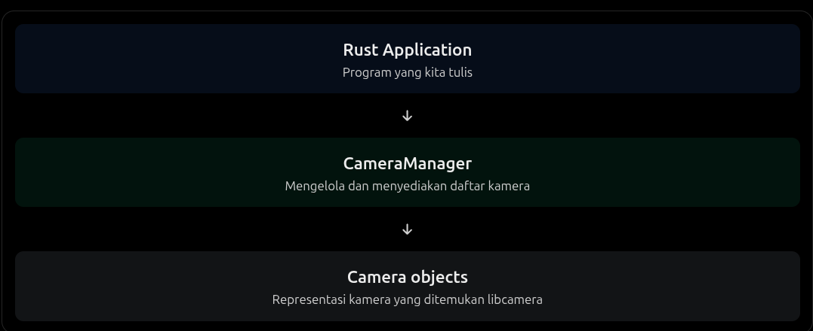

# CameraManager

Di libcamera, tugas menemukan dan mengelola kamera tersebut ditangani oleh `CameraManager`:

Sederhananya, `CameraManager` adalah titik awal untuk menemukan kamera. Ia belum mengambil gambar atau memulai proses streaming.

## Perbandingan YUYV vs MJPEG

Semisal dengan resolusi 640x480 pada 30 FPS :

| Aspek         | YUYV                      | MJPEG                 |
| ------------- | ------------------------- | --------------------- |
| Kompresi JPEG | Tidak                     | Ya                    |
| Ukuran frame  | tetap                     | bervariasi            |
| Bandwith      | Relatif besar             | Relatif kecil         |
| Decoding      | Tidak perlu JPEG decoding | perlu JPEG decoding   |
| Akses piksel  | Langsung dari data YUYV   | Setelah JPEG decoding |
