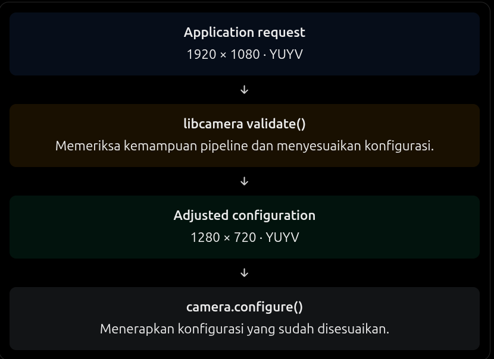

# Camera Configuration

Pada milestone ini berisi mengendalikan format dan resolusi stream kamera. Penting karena sebelum kamera bisa menghasilkan frame, kita harus menentukan bagaimana frame tersebut akan direpresentasikan:

Targetnya membuat program camera-configurator yang bisa :

- Membuat konfigurasi ViewFinder
- Mengubah pixefl format dari MJPEG menjadi YUVY
- Mengubah resolusi
- Memvalidasi konfigurasi
- Menerapkan konfigurasi ke kamera.

## Memahami lifecycle konfigurasi

Sebelumnya sudah menjalankan :

```rust
let config = camera
    .generate_configuration(&[StreamRole::ViewFinder])
    .unwrap();
```

Namun menghasilkan konfigurasi belum berarti kamera menggunakannya. Urutan yang akan dipelajari :

```
1. Generate

Meminta libcamera membuat konfigurasi awal.

2. Modify

Mengubah resolusi dan pixel format.

3. Validate

Memeriksa apakah konfigurasi dapat digunakan dan melihat penyesuaian yang diperlukan.

4. Configure

Menerapkan konfigurasi ke kamera.

5. Start

Memulai kamera. Ini akan kita pelajari pada milestone capture.
```

validate() dan configure() memiliki tanggung jawab berbeda.

- validate() memeriksa dan dapat menyesuaikan konfigurasi
- configue() menerapkan konfigurasi tersebut ke kamera.

## Mengenal StreamRole

Beberapa contoh StreamRole yang umum:

| StreamRole     | Tujuan                            |
| -------------- | --------------------------------- |
| ViewFinder     | Preview kamera                    |
| VideoRecording | Perekaman video                   |
| StillCapture   | Pengambilan foto                  |
| Raw            | Data sensor mentah, jika didukung |

StreamRole bukan pixel format.

- ViewFinder : tujuan stream
- YUYV : cara data piksel disimpan

Contohnya, kita bisa meminta stream ViewFinder dengan pixel format YUYV.

## Memahami bagian code

**A. camera.acquire()**

```rust
let mut camera = camera.acquire().expect("Acquire camera");
```

Ini meminta akses ekslusif ke kamera. Mengapa perlu?

Bayangkan 2 aplikasi mencoba mengonfigurasi kamera yang sama pada waktu bersamaan. Hal tersebut bisa menyebabkan konflik. Karena itu, sebelum mengonfigurasi kamera, aplikasi perlu melakukan acquisition.

| Operasi            | Fungsi                  |
| ------------------ | ----------------------- |
| manager.cameras()  | Menemukan kamera        |
| camera.acquires()  | Meminta akses ke kamera |
| camera.configure() | Menerapkan konfigurasi  |
| camera.start()     | Memulai capture         |

**B. config.validate()**

```rust
let status = config.validate();
```

Misalnya kita meminta:

Pixel format: YUYV

Resolution : 640x480

Libcamera akan memeriksa apakah konfigurasi tersebut dapat digunakan

Kemungkinan hasil validasi mencakup :

- valid : konfigurasi dapat digunakan tanpa perubahan
- Adjusted : konfigurasi disesuaikan agar sesuai kemampuan perangkat
- Invalid : konfigurasi tidak dapat digunakan

Jadi, jangan berasumsi konfigurasi yang kita minta pasti sama dengan konfigurasi akhirnya.

## ownership dan lifecycle kamera

Selama objek hasil acquire() masih hidup, aplikasi memegang akses tersebut. Ketika objek dilepas (dropped), akses kamera dapat dilepaskan kembali.

```
CameraManager
     |
     └── Camera
           |
           └── acquire()
                 |
                 └── Camera yang sudah acquired
                         |
                         ├── configure()
                         ├── start()
                         ├── stop()
                         └── drop()
```

## Adjusted


Point penting: setelah validate(), aplikasi harus membaca kembali konfigurasi. Jangan terus mengasumsikan nilai yang diminta sebelumnya masih berlaku.
