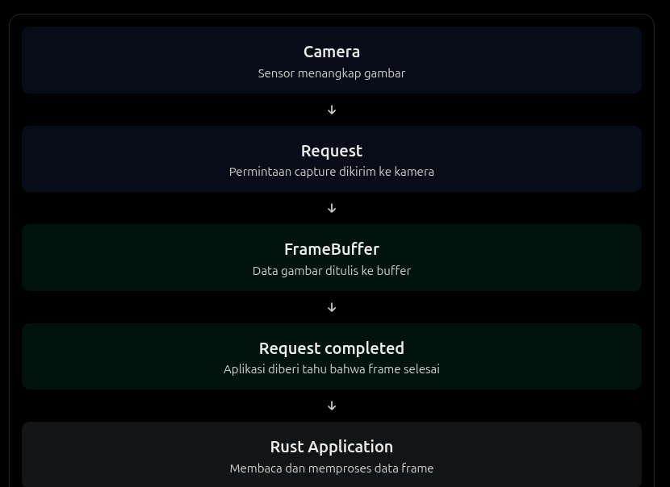
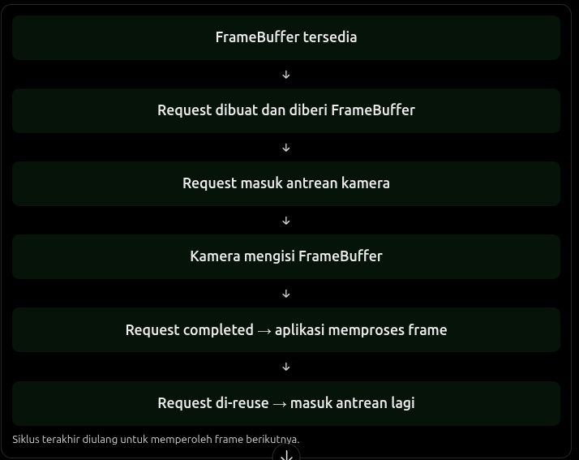
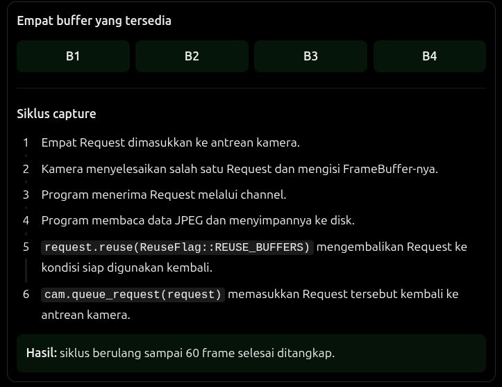

## Frame Capture

Target akhirnya adalah memahami bagaimana data gambar berpindah dari hardware kamera ke program Rust.

Akan membangun program secara bertahap :

- camera-snapshot : mengambil satu frame
- camera-recorder : mengambil frame secara berulang
- camera-frame-monitor : memantau FPS dan informasi frame

## Alur Capture

Ada beberapa objek baru yang perlu kita kenali :

- Camera : perangkat kamera yang sudah kita acquire dan configure
- Request : permintaan kepada kamera untuk menghasilkan satu atau beberapa stream frame.
- FrameBuffer : tempat data frame ditulis oleh pipeline kamera
- Completion : pemberitahuan bahwa request sudah selesai diproses
  
  Request bukan gambar itu sendiri. Request adalah objek yang mengatur pekerjaan capture, sedangkan data gambarnya berada di buffer.

## camera-snapshot

Untuk eksperimen pertama, kita akan menggunakan MJPEG, bukan YUYV. Kenapa?

Karena MJPEG sudah berisi data JPEG. Kita bisa menyimpan hasil capture langsung menjadi file .jpg tanpa melakukan encoding JPEG lagi.

Alur:

```
USB Camera
    |
    v
libcamera
    |
    v
MJPEG FrameBuffer
    |
    v
MemoryMappedFrameBuffer
    |
    v
output.jpg
```

## Konsep baru

**A. FrameBufferAllocator**

```rust
let mut allocator = FrameBufferAllocator::new(&cam);
let buffers = allocator.alloc(&stream).unwrap();
```

Tugasnya menyediakan buffer untuk menampung frame hasil capture. Bayangkan kamera membutuhkan tempat untuk menulis data gambar. Allocator menyediakan tempat tersebut.

**B. MemoryMappedFrameBuffer**

```rust
let buffer = MemoryMappedFrameBuffer::new(buf).unwrap();
```

FrameBuffer biasa belum tentu bisa langsung dibaca sebagai slice byte (&[u8]). Dengan memory mapping, kita bisa isi buffer melalui memori proses aplikasi. Ini berkaitan dengan konsep `mmap()`.

**C. Request**

```rust
let mut request = cam.create_request(None).unwrap();
request.add_buffer(&stream, buffer).unwrap();
```

Request menghubungkan:

- Permintaan capture
- Stream yang digunakan
- Buffer tempat hasil gambar disimpan

Setelah itu request dimasukkan ke antrean kamera menggunakan `queue_request()`.

## Memahami mekanisme asynchronous

Bagian code :

```rust
let (tx, rx) = std::sync::mpsc::channel();

cam.on_request_completed(move |request| {
    tx.send(request).unwrap();
});
```

Ini bagian yang penting. `on_request_completed()` mendaftarkan callback yang dipanggil ketika request selesai diproses.

Kita mengirimkan request yang selesai ke channel:

- tx: pengirim request yang sudah selesai
- rx: penerima request yang sudah selesai

Kemudian :

```rust
let request = rx
    .recv_timeout(Duration::from_secs(5))
    .expect("Camera request timeout");
```

Program menunggu sampai request selesai, maksimal 5 detik. Jadi aplikasi tidak perlu melakukan polling terus-menerus untuk memeriksa apakah kamera sudah menghasilkan frame.

## Memahami siklus FrameBuffer

Sebelum membuat recorder, pahami alur berikut:

Pada snapshot, kita hanya mengantrekan satu Request. Pada recorder, kita akan mengantrekan beberapa Request dan menggunakannya berulang kali.

## Continuous Capture / Camera Recorder

Pada eksperimen sebelumnya (camera-snapshot.rs), kita hanya mengambil satu frame. Sekarang targetnya mengambil 60 frame MJPEG secara berurutan dan menyimpannya sebagai 60 file JPEG.

Ada satu konsep: **Request reuse**. Kita tidak perlu membuat Request dan FrameBuffer baru untuk setiap frame. Setelah frame selesai diproses, Request yang sama bisa digunakan kembali untuk meminta frame berikutnya.

Alurnya:

```
Request 1 ──> Capture frame 1 ──> Simpan JPEG
    ↑                                  │
    └──────────── Reuse ───────────────┘

Request 2 ──> Capture frame 2 ──> Simpan JPEG
    ↑                                  │
    └──────────── Reuse ───────────────┘
```

Untuk sekarang, kita gunakan 4 Request sesuai jumlah buffer yang dialokasikan kamera.

## Memahami yang terjadi di camera-recorder.rs

Kita mengalokasikan 4 framebuffer, tetapi berhasil menghasilkan 60 frame. Bagaimana mungkin?

Perhatikan siklus:

Jadi, ada 2 angka yang perlu dibedakan:

- 4: jumlah buffer yang tersedua untuk pipeline capture.
- 60: jumlah frame yang berhasil diproses disimpan.
  Kita tidak membuat 60 buffer. Kita menggunakan kembali 4 buffer yang sama.

## Mengapa Request tidak boleh langsung di-requeue?

Misalnya kamera sedang mengisi Buffer 1. Kalau aplikasi memasukkan Buffer 1 kembali ke antrean sebelum kamera selesai menggunakannya, bisa terjadi konflik akses.

Karena urutannya harus:

```
Camera writes buffer
        ↓
Request completed
        ↓
Application reads buffer
        ↓
Application finishes processing
        ↓
Request reuse
        ↓
Queue request again
```

## camera-frame-monitor.rs

3 konsep yang perlu diperhatikan:

**A.Sequence Number**

```rust
let sequence = request.sequence();
```

Sequence number berasal dari Request yang selesai diproses. Ini membantu kita mengamati urutan frame dari kamera.

**B. FPS**

```rust
let fps = window_frames as f64 / window_elapsed.as_secs_f64();
```

Kita menghitung berapa frame yang selesai diterima dalam interval waktu tertentu.

Bedakan :

- FPS kamera: seberapa cepat kamera menghasilkan frame
- FPS aplikasi: seberapa cepat aplikasi menerima dan memproses frame

Dalam eksperimen ini, yang kita ukur adalah FPS penerimaan Request oleh aplikasi.

**C. Metadata**

```rust
let metadata = framebuffer.metadata().unwrap();

let jpeg_len = metadata
    .planes()
    .get(0)
    .unwrap()
    .bytes_used as usize;
```

Kita tidak membaca seluruh isi buffer. Kita hanya mengambil informasi ukuran data frame yang benar-benar digunakan.
